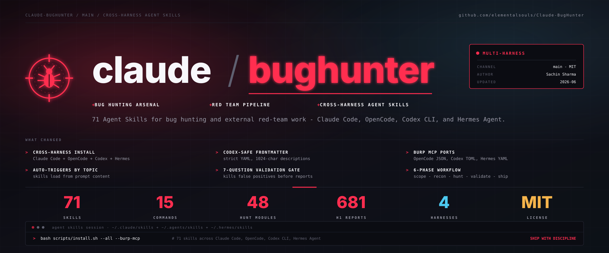

# claude-bughunter (web edition)

> A self-contained Claude skill bundle for **web application** bug hunting · **62 skills** · 16 slash commands · **681 disclosed-report patterns** across 24 core vulnerability classes · web recon · reporting & validation gates · Burp MCP integration · exercised against public training platforms (DVWA, OWASP Juice Shop, Hacker101, testphp.vulnweb.com).

> **This is a web-focused fork.** The enterprise-identity, cloud/infra, red-team, Web3, mobile/APK, and general-OSINT skills from the upstream bundle have been removed — what remains is the web application pentest / bug-bounty surface only.

Originally built by **[Sachin Sharma](https://www.linkedin.com/in/sachinsharma8080/)** — Bug Hunting & GenAI Security Research.

---

## What is this?

`claude-bughunter` is a drop-in skill bundle for the [Claude Code skills system](https://docs.claude.com/en/docs/claude-code/skills). Install once and Claude Code stops being a chatbot and starts behaving like a senior web-app bug-hunting researcher: it knows the techniques, the chain templates, the VRT mappings, and the hygiene — and it stays in scope.

Three layers stack:

- **Think** — `bb-methodology`: the 5-phase non-linear workflow and critical-thinking framework.
- **Hunt webapps** — 45 `hunt-*` skills curated from 681 disclosed HackerOne reports: per-class detection patterns, payloads, bypass tables, and chain templates.
- **Ship it** — `triage-validation` + reporting + `evidence-hygiene`: the 7-Question Gate, VRT-aware severity, OOS rebuttals, PII redaction.

All triggered automatically by topic — describe what you're testing in plain English and the relevant skill loads. No invocation by name.

---

## Quickstart

**Copy install (from this clone):**

```bash
cd Claude-BugHunter
bash scripts/install.sh        # copies skills + commands into ~/.claude/
```

That's it. Open Claude Code and describe what you're testing in plain English — the right skill loads automatically, no invocation by name:

```text
> Testing acme.com — an in-scope HackerOne target. Run recon and rank the surface.

  ⟳ loading skills: web2-recon, hunt-subdomain, bb-methodology …
    → subdomain enum (subfinder + crt.sh) … 47 hosts
    → live hosts (httpx) … 12 · tech fingerprint … 6 distinct stacks
    → ranked surface: api.acme.com (GraphQL, introspection ON)  ← start here
                      auth.acme.com (OAuth, SSO)               ← hunt-oauth

  Next: want me to probe the GraphQL introspection + OAuth redirect_uri?
```

→ Full [Installation guide](INSTALL.md) · [Usage guide](USAGE.md) · [searchable skill catalog](docs/skills.md).

> The block above is an illustrative transcript.

---

## Scope — what this bundle is for, and what it isn't

This bundle covers the **web application attack surface** — anything reachable over HTTP(S) from the internet.

### In scope

- **Bug bounty hunting** — web apps, APIs, SaaS, GraphQL, OAuth, JWT, file upload, IDOR, SSRF, RCE chains
- **Web application pentesting** — full `hunt-*` coverage of OWASP-mapped bug classes + discipline rules
- **Web recon** — subdomain enum, source/JS-map leakage, TLS/DNS misconfig, tech fingerprinting
- **Reporting** — H1, Bugcrowd (VRT-aware), Intigriti

### Out of scope (removed in this fork — by design)

- **Internal Active Directory attacks** — BloodHound, Kerberoasting, DCSync, Pass-the-Hash, AD CS abuse, etc.
- **Enterprise identity / infrastructure red-team** — M365/Entra, Okta, vCenter, SSL-VPN appliances, cloud IAM escalation.
- **C2 frameworks, post-exploit, persistence, lateral movement, evasion.**
- **Web3 / smart-contract auditing · mobile/APK · binary exploitation · ICS/RF/hardware.**
- **General OSINT / attribution / crypto-tracing.**

If you need those phases, use the upstream bundle at [elementalsouls/Claude-BugHunter](https://github.com/elementalsouls/Claude-BugHunter) — this fork intentionally keeps only the web surface.

---

## What's inside

**62 skills**, auto-loaded by topic — no invocation by name. Coverage across the web attack surface:

**NEW (2026-08-13):** Auto-intelligence layer — three new engines that make Claude self-improving:
- **Technique auto-classifier** (`engine/technique_classifier.py`) — 50+ pattern mappings, automatically classifies findings from notes/evidence during `/remember`
- **Pattern analytics** (`scripts/pattern-analytics.py`) — analyzes hunt-memory to find what techniques actually work on which stacks, with success rates and payout averages
- **CVE automation** (daily cron) — fresh CISA KEV coverage every morning at 2:30 AM, auto-updates `docs/cve-coverage.md`

| Category | Examples |
|---|---|
| Injection & code exec | XSS, SQLi, SSRF, RCE, SSTI, XXE, LFI, NoSQLi, deserialization, LDAP |
| Auth & identity | auth-bypass, session, OAuth, SAML, MFA-bypass, ATO |
| Access control & logic | IDOR, CSRF, business-logic, race-condition |
| API & protocol | GraphQL, gRPC, WebSocket, API-misconfig, CORS, host-header |
| Advanced web | HTTP smuggling, cache-poison, open-redirect, brute-force, LLM/AI features |
| Framework-specific | Next.js, Node.js, Laravel, Spring Boot, ASP.NET, SharePoint |
| Recon & surface | web2-recon, subdomain, source-leak, tls-network, ntlm-info |
| Workflow, reporting & specialized | methodology, triage-validation, evidence-hygiene, VRT-aware reporting |

Full searchable catalog → **[docs/skills.md](docs/skills.md)**. Also ships **16 slash commands** (`/hunt`, `/recon`, `/report`, …) and a deterministic **engagement engine** (`engine/`) that maps a target's attack surface and routes each finding to the skill that handles it.

---

## How it works

A 6-phase, non-linear workflow — **recon → map & rank → hunt → validate → report** — with scope enforced in code and a **7-Question Gate** before anything is submitted. Two ways to drive it:

- **Plain English** — describe what you're testing and the relevant skill loads automatically.
- **`/hunt` scaffold + `cbh` CLI** — engagement-folder structure, state, and orchestration.

→ [Usage guide & worked example](USAGE.md) · [6-phase architecture & skill-to-phase map](docs/architecture.md) · [`cbh` CLI](docs/cbh-cli.md)

---

## Authorization

These skills are intended for assets you **own** or have **written authorization to assess** (bug-bounty in-scope assets, pentest engagement letters, CTF challenges, your own infrastructure).

The skills include validation gates that auto-trigger when you point Claude at unverified third-party targets — `triage-validation`'s 7-Question Gate explicitly asks whether the asset is in scope (Q3) and on the program's accepted-impact list (Q2).

The bundle explicitly **excludes**: weaponizing 0-days against unauthorized targets, post-exploitation tooling, malware development, mass-targeting infrastructure. See [`SECURITY.md`](SECURITY.md) for the full posture.

> **Heads-up — Anthropic runtime cyber safeguards.** Anthropic's models apply real-time safeguards that **block "vulnerability exploitation or offensive security tooling development" by default** — so even *authorized, in-scope* work can hit a refusal that isn't this bundle's doing. If you do authorized offensive security (pentest / bug bounty), enroll in Anthropic's **free, application-based [Cyber Verification Program (CVP)](https://claude.com/form/cyber-use-case)** to get safeguards adjusted for legitimate dual-use work. Details: [Anthropic — real-time cyber safeguards](https://support.claude.com/en/articles/14604842-real-time-cyber-safeguards-on-claude).

---

## Documentation

| Doc | Contents |
|---|---|
| [`README.md`](README.md) | This file — overview, quickstart, scope, skill summary |
| [`INSTALL.md`](INSTALL.md) | Full setup with Burp MCP integration and optional skill regenerator |
| [`USAGE.md`](USAGE.md) | Workflow walkthrough · decision tree · worked engagement example |
| [`docs/architecture.md`](docs/architecture.md) | 6-phase architecture · skill-to-phase mapping · engagement composition |
| [`docs/cbh-cli.md`](docs/cbh-cli.md) | `cbh` CLI — native runner orchestrating recon + classify + triage + report |
| [`docs/cve-coverage.md`](docs/cve-coverage.md) | CISA KEV coverage snapshot |
| [`docs/credits.md`](docs/credits.md) | Attribution for original + vendored skills |
| [`CONTRIBUTING.md`](CONTRIBUTING.md) | PR guidelines · skill quality standards · scope |
| [`SECURITY.md`](SECURITY.md) | Authorized-use posture · responsible disclosure · what's excluded |
| [`LICENSE`](LICENSE) | MIT |

---

## Why this exists

Most bug-hunting Claude setups are either too generic (one big "security" prompt) or too fragmented (you bookmark 30 disclosed reports and re-read them every engagement). Neither scales past the second target.

The per-class `hunt-*` skills address gap-zero (*"what should I look for in webapps"*) — codifying patterns from 681 disclosed HackerOne reports, so Claude knows the actual chain templates real triagers paid for, not abstract OWASP Top 10. Four gaps a starter 3-skill stack could not close, that this bundle does:

1. **No hypothesis discipline** — drafts written before validation → wasted hours, hurt validity ratio
2. **No per-program reporting tactics** — VRT defaults auto-downgraded P3-worthy findings to P4
3. **No engagement coordination** — findings, evidence, and submission IDs scattered across folders
4. **No evidence hygiene** — screenshots leaked cookies and victim PII

---

## About

Operational tradecraft accumulated across bug-bounty engagements and authorized web pentests, codified into Claude skills. This is a **web-only fork** of [elementalsouls/Claude-BugHunter](https://github.com/elementalsouls/Claude-BugHunter).

**Original author:** [ElementalSoul](https://github.com/elementalsouls) · GenAI Security Research

**Vendored foundation:** [shuvonsec/claude-bug-bounty](https://github.com/shuvonsec/claude-bug-bounty) — methodology, validation, reporting, payload library

**Tool inventory:**
- [PortSwigger Burp Suite + MCP Server extension](https://portswigger.net/burp)
- [ProjectDiscovery](https://github.com/projectdiscovery) — subfinder · dnsx · httpx · katana · nuclei
- [SecLists](https://github.com/danielmiessler/SecLists) · [Assetnote Wordlists](https://wordlists.assetnote.io/)

**License:** [MIT](LICENSE) — use freely, attribution appreciated.

---

> *"Give Claude the right skill and it stops being a chatbot. It becomes an operator."*
