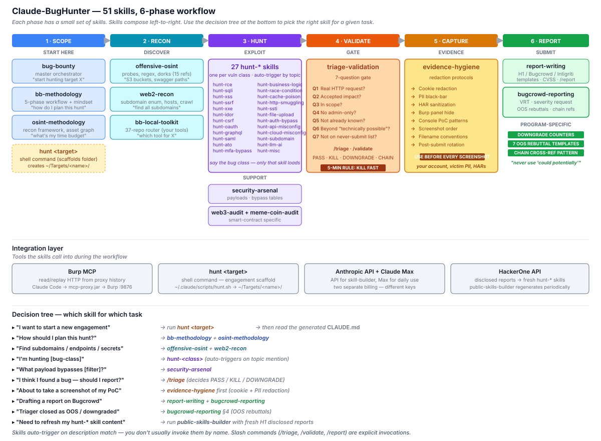
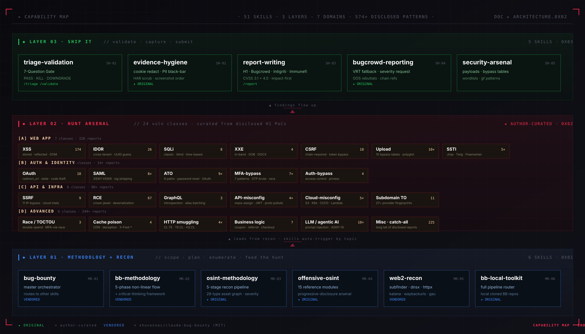
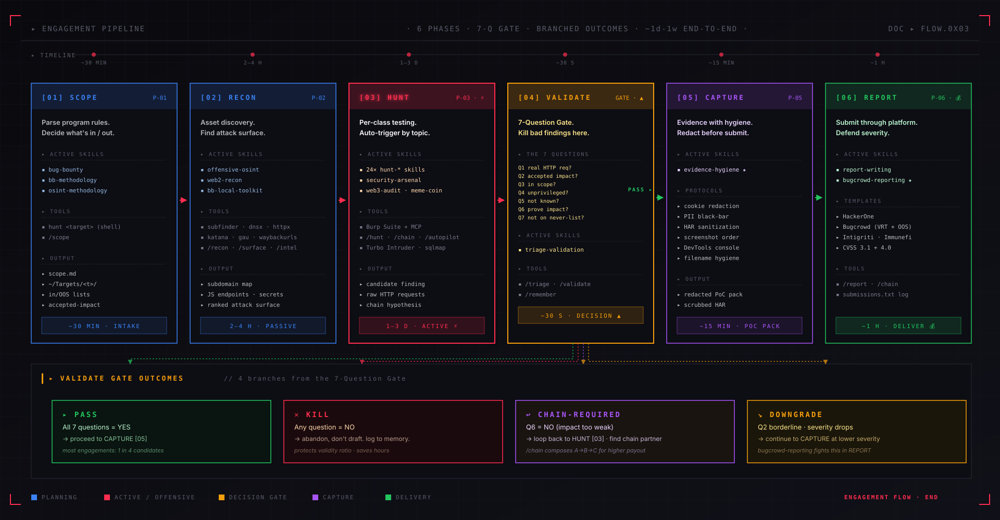

# Architecture

The Claude-BugHunter bundle (web edition) maps to a 6-phase workflow for web application bug hunting. Each phase has a focused set of skills; skills compose left-to-right as you move through the workflow, but you can jump in at any phase mid-engagement.

## Primary view — phase-by-phase architecture

66 skills mapped to 6 phases, with a 55-skill `hunt-*` sub-stack, integration layer, and usage decision tree. This is the main reference for "which skill do I use when?".



The "Source" column in the per-phase tables below tags each skill: **`original`** = author's work in this repo, `community` = community-contributed (v3), `vendored` = from [shuvonsec/claude-bug-bounty](https://github.com/shuvonsec/claude-bug-bounty) (MIT).

## Alternate view — 3-layer capability stack

The same 66 skills, regrouped by **role in an engagement** rather than by phase. Methodology + Recon (bottom) feeds the Hunt Arsenal (middle), which produces findings that flow up through Ship It (top) to a paid submission.



## Alternate view — engagement pipeline with branched outcomes

The 6-phase workflow expanded into a pipeline showing per-phase active skills, tools, output, time budgets, and the **4 branched outcomes** of the Validate gate (PASS · KILL · CHAIN-REQUIRED · DOWNGRADE).



---

---

## Phase 1 — SCOPE (program intake, planning)

**Use when**: starting a new program, parsing scope, deciding what's in/out

| Skill | Source | Purpose |
|---|---|---|
| `bug-bounty` | vendored | Master orchestrator — pulls in other skills as needed |
| `bb-methodology` | vendored | 5-phase workflow + hunting mindset |
| **`bb-local-toolkit`** | original | Full pipeline router for local cloned bug-bounty repos |
| **`hunt <target>` (shell)** | original | Scaffolds `~/Targets/<name>/` with full template |

## Phase 2 — RECON (discovery)

**Use when**: asset enumeration, subdomain discovery, secret hunting, tech fingerprinting

| Skill | Source | Purpose |
|---|---|---|
| `web2-recon` | vendored | Subdomain enumeration, host discovery, URL crawling |
| **`hunt-subdomain`** | original | Subdomain enum + takeover detection |
| **`hunt-source-leak`** | original | JS source-map / .git / .env / secret leakage — run at recon start |
| **`bb-local-toolkit`** | original | Routes to local cloned bug-bounty repos when applicable |

## Phase 3 — HUNT (active testing)

**Use when**: testing for specific vulnerability classes

| Skill | Source | Purpose |
|---|---|---|
| **44 `hunt-*` skills** | original + community | Per vuln class / framework, curated from disclosed H1 reports + v3 community expansion — auto-trigger by topic |
| **Class-agnostic track** (3) | original | Findings the taxonomy has no name for — see below |
| `security-arsenal` | vendored | Payload library (XSS / SSRF / SQLi / SSTI / etc.) |

### Per-class hunt skills (44)

```
hunt-api-misconfig                      hunt-mfa-bypass
hunt-aspnet           (1)               hunt-misc             (225)
hunt-ato                                hunt-nextjs           (19)
hunt-auth-bypass      (12)              hunt-nodejs           (24)
hunt-brute-force      (33)              hunt-nosqli           (14)
hunt-business-logic   (12)              hunt-ntlm-info        (1)
hunt-cache-poison     (10)              hunt-oauth            (19)
hunt-cors             (19)              hunt-open-redirect    (28)
hunt-csrf             (15)              hunt-race-condition   (12)
hunt-deserialization  (22)              hunt-rce              (67)
hunt-dom              (17)              hunt-saml
hunt-file-upload                        hunt-session          (18)
hunt-graphql          (12)              hunt-sharepoint       (1)
hunt-grpc             (6)               hunt-source-leak      (31)
hunt-host-header      (16)              hunt-springboot       (16)
hunt-http-smuggling                     hunt-sqli             (12)
hunt-idor             (26)              hunt-ssrf             (15)
hunt-laravel          (14)              hunt-ssti
hunt-ldap             (8)               hunt-subdomain        (15)
hunt-lfi              (31)              hunt-tls-network      (9)
hunt-llm-ai                             hunt-websocket        (11)
                                        hunt-xss              (174)
                                        hunt-xxe              (10)
```

Plus the meta-router `hunt-dispatch` (used internally by the `/hunt` slash command — not user-invoked).

### Class-agnostic track (3)

A vuln-class taxonomy is a survivorship filter: it can only hand back a name it already has. These three run **beside** the per-class skills and never name a class — they look for the contradictions a class list would miss.

| Skill | Trigger | Backed by |
|---|---|---|
| `hunt-anomaly` | the app believes a header, an older API still answers, a safe method fires an action, an answer never moves | `engine/anomaly.py` (`/anomaly`) |
| `hunt-differential` | hold everything still, move exactly one dimension, diff the two answers | `engine/diff_matrix.py` (`/oracle`) |
| `hunt-invariants` | make something impossible happen (negative balance, double refund, discount > cart) | `engine/anomaly.py` invariants |

Companion pieces: `engine/coverage.py` (the negative space — which dimension was *ever* varied; a request is not a test), `bb-parallel-roles` (more than one mind on the target), `/debrief` + `/learn` (close the session on facts, grow the map from what actually happened). Every row these emit carries `not_a_finding_until` — a plan/anomaly is an open thread, never a result.

**Total disclosed reports curated**: 681

**How auto-triggering works**: just describe what you're testing — e.g., *"I see a `?url=` parameter on this endpoint"* — and Claude loads only `hunt-ssrf`. You don't invoke them by name.

## Phase 4 — VALIDATE (the gate before reporting)

**Use when**: you think you have a finding — BEFORE drafting any report

| Skill | Source | Purpose |
|---|---|---|
| `triage-validation` | vendored | 7-Question Gate, 4 pre-submission gates, never-submit list |

Slash commands: `/triage`, `/validate`

The 7-Question Gate:

1. Can an attacker use this RIGHT NOW with a real HTTP request?
2. Is the impact on the program's accepted impact list?
3. Is the asset in scope?
4. Does it work without privileged access an attacker can't get?
5. Is this not already known or documented behavior?
6. Can impact be proved beyond "technically possible"?
7. Is this not on the never-submit list?

One NO = KILL. Move on. This single discipline is what separates productive researchers from the noise.

## Phase 5 — CAPTURE (evidence hygiene)

**Use when**: about to take a screenshot, export a HAR, or attach evidence

| Skill | Source | Purpose |
|---|---|---|
| **`evidence-hygiene`** | original | Cookie redaction, PII black-bar, HAR sanitization, screenshot capture order |

Covered protocols:
- Cookie redaction (which fields, what tools, screenshot timing)
- PII black-bar (other-user data, faces, addresses, SSNs)
- HAR file sanitization (jq filters)
- Burp screenshot hygiene (Repeater, Intruder, Proxy)
- DevTools Console PoC patterns
- Filename conventions for multi-step PoCs
- Post-submission rotation hygiene

## Phase 6 — REPORT (submission)

**Use when**: drafting the final report

| Skill | Source | Purpose |
|---|---|---|
| `report-writing` | vendored | H1 / Bugcrowd / Intigriti / Immunefi templates, CVSS 3.1 + 4.0 |
| **`bugcrowd-reporting`** | original | Bugcrowd VRT search, severity-request paragraph, OOS rebuttals |

Slash command: `/report`

---

## Integration layer

Tools the skills call into during the workflow.

| Tool | Purpose |
|---|---|
| **Burp MCP** | Claude reads/replays HTTP traffic directly from Burp's proxy history. Eliminates manual paste-curl-into-chat. |
| **`hunt` shell command** | Engagement-folder scaffold (`~/Targets/<name>/CLAUDE.md` + scope.md + findings/ + evidence/ + submissions.txt + notes.md + .gitignore). |
| **HackerOne API** | Used externally with `public-skills-builder` to refresh `hunt-*` skill content from newly disclosed reports. |

---

## Composition example — full engagement walkthrough

```
1. SCOPE
   $ hunt acme-bb              → scaffolds ~/Targets/acme-bb/
   $ cd ~/Targets/acme-bb
   $ claude                    → opens Claude Code in this folder
   "Help me parse the program page into scope.md"
   → triggers bb-methodology, populates scope.md

2. RECON
   "Run external recon on *.acme.com"
   → triggers web2-recon + hunt-subdomain + hunt-source-leak
   → suggests: certificate transparency, JS endpoint extraction, source-map recovery

3. HUNT
   "I see /api/users/{id}/orders in JS — testing IDOR with two test accounts"
   → triggers hunt-idor
   → walks through detection patterns, payloads, two-account verification

4. VALIDATE
   /triage
   "I get back the victim's order data when I change the user_id"
   → 7-Question Gate
   → returns PASS (assuming all checks pass)

5. CAPTURE
   "About to take a screenshot of the IDOR PoC"
   → triggers evidence-hygiene
   → reminds you to redact cookies, mask victim PII

6. REPORT
   /report
   → triggers report-writing + bugcrowd-reporting
   → produces ready-to-paste body + VRT mapping + severity request paragraph
```

---

## Skill-loading mechanics

**Auto-trigger**: Skills load when their description matches your prompt. The skill matcher uses the `description` field in the YAML frontmatter.

**Progressive disclosure**: Large skills keep SKILL.md lean and put detailed reference content in subfolders that load only when needed.

**Slash commands**: Some skills have explicit slash-command invocations (`/triage`, `/validate`, `/report`, `/recon`, `/hunt`, `/scope`, etc.) that force-load the relevant skill.

---

## What's NOT in the bundle (intentional gaps)

- **No scanner** — there is no broad automated sweep, and every engagement in this workspace forbids one. `nuclei`/`dalfox` are installed but policy-restricted to a single targeted template against an already-confirmed fingerprint; `sqlmap` is deliberately absent.
  This is *not* the same as "never fires a request", which earlier versions of this page claimed. `engine/poc_runtime.py` fires PoC specs, `cbh recon` probes live hosts, and `engine/engine.py --hunt` dispatches headless agents that send requests. All of it goes through `engine/request_broker.py`: scope-verified (deny-wins, default-deny, DNS-resolution gate for netblock programs), paced against the engagement's global budget, mandatory headers injected, every request audited to `hunt-memory/audit.jsonl` and every response body stored. Burp and Playwright reach the network themselves and are gated separately by `scripts/mcp-gate.py`.
- **No CI/CD integration** — this is a workflow stack for individual researchers, not a continuous scanning pipeline.
- **No secret leak deletion** — if the stack helps you find leaked credentials, you (and the program) handle remediation.
- **Web surface only** — enterprise identity/infra, cloud, red-team, Web3, and mobile are out of scope in this fork (see the upstream bundle for those).

---

## Further reading

- [USAGE.md](../USAGE.md) — full usage walkthrough with worked example
- [INSTALL.md](../INSTALL.md) — step-by-step setup
- [docs/credits.md](credits.md) — full attribution to upstream sources
- [shuvonsec/claude-bug-bounty](https://github.com/shuvonsec/claude-bug-bounty) — vendored foundation
